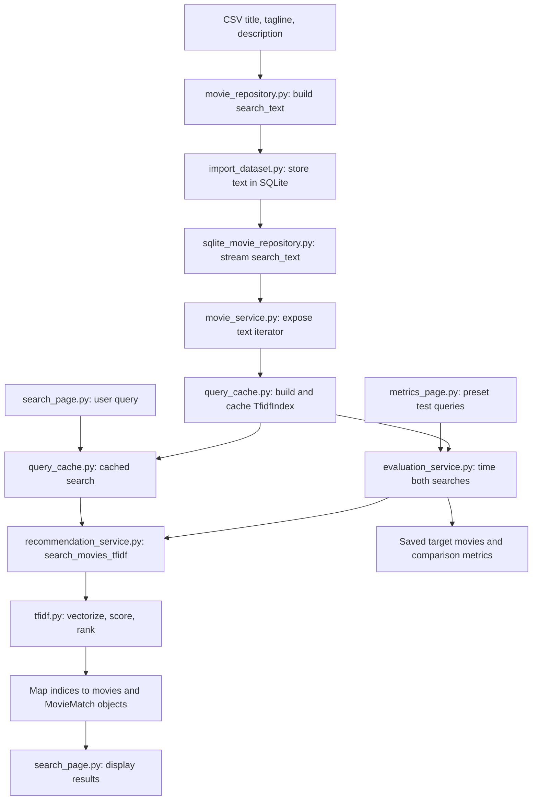

# TF-IDF code guide for CineNexus

TF-IDF means **Term Frequency–Inverse Document Frequency**. It turns text into numerical word weights so the application can compare a user's query with movie text. Words that occur in fewer movies can help distinguish a match from the rest of the catalog.

This guide contains actual excerpts from the current source files and explains their roles. Some files implement the new TF-IDF feature; others are existing components it reuses. The snippets are for reading, not a standalone program. Source line numbers describe the version used to write this guide.

## How the pieces connect



The index is fitted on movie text once per cached dataset. Each search transforms the query using that existing vocabulary; it does not fit a new vocabulary on the query.


## 1. Prepare the movie descriptions (existing code)

Source: [repositories/movie_repository.py](repositories/movie_repository.py), lines 82–87.

```python
        def build_search_text(row):
            parts = [row["title"], row["tagline"], row["overview"],]

            return ". ".join(str(part).strip() for part in parts if str(part).strip())

        df["search_text"] = df.apply(build_search_text, axis=1)
```

`build_search_text()` combines the title, tagline, and overview into one string. Earlier in this file, the CSV column `description` is renamed to `overview`.

This is why TF-IDF can search descriptions: their words are included in the text it receives. It also searches the title and tagline. Actors, directors, and genres are not added by this function.


## 2. Store the searchable text (existing code)

Source: [scripts/import_dataset.py](scripts/import_dataset.py), lines 15–28.

```python

def insert_batch(connection, movie_rows, actor_rows, director_rows, genre_rows, studio_rows, theme_rows,):
    if movie_rows:
        connection.executemany(
            """
            INSERT INTO movies (
                id, title, normalized_title, year,
                tagline, overview, duration, rating,
                search_text, embedding_index
            )
            VALUES (?, ?, ?, ?, ?, ?, ?, ?, ?, ?)
            """,
            movie_rows,
        )
```

The importer inserts `search_text` and `embedding_index` alongside the movie details. `search_text` is the combined text above; `embedding_index` records the movie's position in the shared search ordering. TF-IDF reuses these database fields without requiring its own table.


## 3. Declare access to the text

Source: [repositories/rdbms_movie_repository.py](repositories/rdbms_movie_repository.py), lines 45–47.

```python
    @abstractmethod
    def iter_search_texts(self):
        pass
```

The abstract repository interface requires an `iter_search_texts()` method. This is a contract for database implementations; `pass` does not perform the actual retrieval.


## 4. Read the text from SQLite

Source: [repositories/sqlite_movie_repository.py](repositories/sqlite_movie_repository.py), lines 318–323.

```python
    def iter_search_texts(self):
        """Stream the corpus so TF-IDF fitting does not copy all descriptions."""
        with closing(self._connect()) as connection:
            cursor = connection.execute("SELECT search_text FROM movies ORDER BY embedding_index")
            for row in cursor:
                yield row["search_text"]
```

This implementation selects the stored search text and yields one movie's text at a time. `yield` avoids first building another complete Python list of descriptions, although the resulting TF-IDF matrix still occupies memory.

`ORDER BY embedding_index` matters: TF-IDF returns matrix row positions, which must map back to the correct movies. `closing(...)` closes the database connection when iteration finishes.


## 5. Expose the text through the service

Source: [services/movie_service.py](services/movie_service.py), lines 36–37.

```python
    def iter_search_texts(self):
        return self.movie_repository.iter_search_texts()
```

This method forwards the request to the repository. The cache can request movie text through `MovieService` without writing SQL itself.


## 6. Build the TF-IDF index and search it

Source: [ml/tfidf.py](ml/tfidf.py), lines 1–25.

```python
import numpy as np
from sklearn.feature_extraction.text import TfidfVectorizer


class TfidfIndex:
    """Sparse, normalized movie vectors in database embedding-index order."""

    def __init__(self, texts):
        self.vectorizer = TfidfVectorizer(
            stop_words="english", max_features=100_000, dtype=np.float32,
        )
        self.matrix = self.vectorizer.fit_transform(texts)

    def search(self, query, top_k=5):
        if top_k <= 0 or not query.strip():
            return [], []
        query_vector = self.vectorizer.transform([query])
        if query_vector.nnz == 0:
            return [], []
        # Both vectors are L2-normalized, so their dot product is cosine similarity.
        scores = (self.matrix @ query_vector.T).tocoo()
        positive = scores.data > 0
        indices, values = scores.row[positive], scores.data[positive]
        order = np.lexsort((indices, -values))[:top_k]
        return indices[order].tolist(), values[order].tolist()
```

This is the core algorithm.

- `TfidfVectorizer(...)` creates the text converter. English stop words such as “the” and “and” are removed. At most 100,000 features are retained, and values use NumPy's 32-bit floating-point type. The default feature unit is an individual word (a unigram).
- `fit_transform(texts)` learns the movie vocabulary and inverse-document-frequency weights, then builds the movie matrix. Rows represent movies; columns represent vocabulary terms. The sparse matrix stores nonzero entries efficiently.
- `top_k` is the maximum number of results requested. Blank queries and nonpositive limits return empty lists.
- `transform([query])` uses the already fitted vocabulary to create the query vector. Words outside that vocabulary are ignored. `nnz == 0` means no nonzero query weights remain, so there are no matches.
- `self.matrix @ query_vector.T` computes a score for every movie. The default L2 normalization makes this dot product equivalent to cosine similarity. `.T` transposes the query vector; `.tocoo()` exposes the sparse result's row numbers and values.
- `scores.data > 0` retains positive matches only.
- `np.lexsort((indices, -values))` sorts by descending similarity, breaking ties by ascending movie index. `[:top_k]` limits the results.
- The return value is two corresponding lists: movie positions and similarity scores.

TF-IDF compares shared words. It does not interpret word order, plot meaning, or synonyms the way a semantic model can. A similarity score is not an accuracy percentage.


## 7. Cache the index and search results

Source: [services/query_cache.py](services/query_cache.py), lines 10–18.

```python
@st.cache_resource(show_spinner="Building the TF-IDF index for this dataset…", max_entries=1)
def get_tfidf_index(dataset_fingerprint: str, _movie_service):
    return TfidfIndex(_movie_service.iter_search_texts())


@st.cache_data(show_spinner=False)
def get_cached_tfidf_search(query, top_k, dataset_fingerprint, _movie_service):
    index = get_tfidf_index(dataset_fingerprint, _movie_service)
    return search_movies_tfidf(query, _movie_service, index, top_k)
```

`get_tfidf_index()` builds `TfidfIndex` from the movie-text iterator. `st.cache_resource` keeps the fitted index in memory for reuse, with at most one cached index entry.

`get_cached_tfidf_search()` obtains that index and runs the search service. `st.cache_data` caches returned search results. The query, result limit, and dataset fingerprint participate in its cache key.

The dataset fingerprint distinguishes datasets. `_movie_service` begins with an underscore so Streamlit excludes that object from hashing; the fingerprint must therefore accurately identify the data. Restarting the application clears the in-memory index. TF-IDF does not write an `embeddings.npz` file.


## 8. Convert ranked positions into movies

Source: [services/recommendation_service.py](services/recommendation_service.py), lines 7–12.

```python
def search_movies_tfidf(query, movie_service, index, top_k=5):
    indices, scores = index.search(query, top_k)
    movie_ids = movie_service.get_movie_ids_by_embedding_indices(indices)
    movies = movie_service.get_movies_by_ids(movie_ids)
    scores_by_id = dict(zip(movie_ids, scores))
    return [MovieMatch(movie=movie, similarity=float(scores_by_id[movie.id])) for movie in movies]
```

`index.search()` returns positions and scores rather than complete movie records. This function maps those positions to movie IDs, loads the movie records, associates each ID with its score, and wraps each result in `MovieMatch`.

The existing `get_movie_ids_by_embedding_indices()` name refers to the shared database ordering. Using it here does not mean TF-IDF uses SBERT embeddings.


## 9. Package each result (existing code)

Source: [domain/recommendation.py](domain/recommendation.py), lines 1–14.

```python
from dataclasses import dataclass
from math import isfinite

from domain.movie import Movie


@dataclass(frozen=True)
class MovieMatch:
    movie: Movie
    similarity: float

    def __post_init__(self):
        if not isfinite(self.similarity):
            raise ValueError("Similarity score must be finite.")
```

`MovieMatch` carries a movie and its similarity score together. Both search methods use this shared result type, allowing the interface to display them in the same way. Its validation rejects non-finite scores such as infinity or NaN.


## 10. Select a method and run the search

Source: [presentation/search_page.py](presentation/search_page.py), lines 17–53.

```python
@st.fragment
def render_semantic_search(movie_service: MovieService, embeddings, model, top_k: int, dataset_fingerprint: str):
    st.subheader("Find a movie")

    with st.form("semantic_search_form"):
        query = st.text_input("Search by title or describe what you want to watch", placeholder="e.g., a space adventure about family")
        method = st.radio("Search method", ["SBERT (Semantic)", "TF-IDF (Baseline)", "Compare both"], horizontal=True)

        submitted = st.form_submit_button("Search")

    if submitted:
        if query.strip():
            results = {}
            try:
                with st.spinner("Searching movies…"):
                    if method != "TF-IDF (Baseline)":
                        results["SBERT"] = get_cached_semantic_search(query.strip(), top_k, dataset_fingerprint, movie_service, embeddings, model)
                    if method != "SBERT (Semantic)":
                        results["TF-IDF"] = get_cached_tfidf_search(query.strip(), top_k, dataset_fingerprint, movie_service)
            except ValueError as exc:
                st.error(f"Could not run search: {exc}")
                return
            st.session_state.movie_search_result = (dataset_fingerprint, top_k, query.strip(), results)
        else:
            st.info("Please enter a search query.")
            return

    saved = st.session_state.get("movie_search_result")
    if saved and saved[:2] == (dataset_fingerprint, top_k):
        st.caption(f'Results for “{saved[2]}” · up to {top_k} per method. Similarity is not an accuracy score.')
        columns = st.columns(len(saved[3]))
        for column, (name, matches) in zip(columns, saved[3].items()):
            with column:
                st.markdown(f"**{name} matches**")
                render_matches(matches)
    else:
        st.info("Enter a title or a plot idea, then click Search.")
```

The radio control offers SBERT, TF-IDF, and comparison mode. The two `if` statements determine which searches run: selecting “Compare both” satisfies both conditions.

`query.strip()` removes whitespace from the ends. The results are stored in Streamlit session state so they remain visible across reruns. The display checks the dataset fingerprint and result count before reusing them. One column is created per method, giving comparison mode two columns.

Despite its existing name, `render_semantic_search()` now handles both search methods.


## 11. Display the matching descriptions

Source: [presentation/search_page.py](presentation/search_page.py), lines 8–15.

```python
def render_matches(results):
    if not results:
        st.info("No matching movies found. Try different words for TF-IDF.")
    for rank, match in enumerate(results, 1):
        movie = match.movie
        st.markdown(f"**{rank}. {movie.title} ({movie.year})** · similarity `{match.similarity:.3f}`")
        st.caption(movie.overview)
        st.divider()
```

This shared renderer prints each movie's rank, title, year, similarity, and description (`movie.overview`). It also displays a message when the result list is empty. It displays results; the matching already happened in the search service.


## 12. Time both methods

Source: [services/evaluation_service.py](services/evaluation_service.py), lines 1–16.

```python
from time import perf_counter

from services.recommendation_service import search_movies, search_movies_tfidf


def compare_searches(query, top_k, movie_service, embeddings, model, tfidf_index):
    """Measure uncached query execution, excluding model/index preparation."""
    results = {}
    for name, search in (
        ("SBERT", lambda: search_movies(query, movie_service, embeddings, model, top_k)),
        ("TF-IDF", lambda: search_movies_tfidf(query, movie_service, tfidf_index, top_k)),
    ):
        start = perf_counter()
        matches = search()
        results[name] = {"matches": matches, "elapsed_ms": (perf_counter() - start) * 1000}
    return results
```

`compare_searches()` runs SBERT and TF-IDF on the same query with the same result limit. Each `lambda` defers its search until the timing loop calls it.

`perf_counter()` measures elapsed time, and multiplication by 1000 converts seconds to milliseconds. Timing includes query processing, ranking, and movie retrieval. It excludes preparing the model or index, which are passed in already prepared. This function calls the search functions directly, bypassing cached search results. Each measurement is a single run.


## 13. Calculate quality against saved targets

Source: [services/evaluation_service.py](services/evaluation_service.py).

`TEST_QUERIES` contains ten exact-title queries, including Inception, Interstellar, and The Shawshank Redemption. Each title was verified to occur once in the bundled catalog, ignoring case and across all years. The queries are selected for title uniqueness, independently of search scores. Each `SearchTestCase` saves a query and its expected movie ID, title, and year. These reference answers are independent of either search method's returned results. They define a known-movie lookup task rather than open-ended semantic relevance.

`evaluate_results(retrieved_ids, expected_ids)` calculates:

| Metric | Meaning |
|---|---|
| Accuracy@1 | 1 if the first result is an expected movie; otherwise 0 |
| Hit@5 | 1 if an expected movie appears among the first five results; otherwise 0 |

Empty predictions score zero. Duplicate retrieved IDs count once, preserving their first occurrence. An empty expected set is rejected. Scores use saved movie IDs. Average Accuracy@1 measures the fraction of queries answered correctly at rank 1; average Hit@5 measures the fraction finding the target within five results.

## 14. Run the preset benchmark

Source: [services/evaluation_service.py](services/evaluation_service.py).

`run_benchmark()` checks the saved IDs, titles, and years against the current dataset. Missing or changed targets are reported as skipped instead of silently receiving a score. For each available case, it calls `compare_searches()` with the same query and result count for SBERT and TF-IDF. Both methods search the full catalog. It scores the returned IDs against the saved target and records the rankings and elapsed search time.

## 15. Show the comparison

Source: [presentation/metrics_page.py](presentation/metrics_page.py).

The **Run test queries** button runs all cases with five results per method, independently of the sidebar search setting. The page stores the report in session state and shows each method's unweighted average scores. The per-query table and CSV contain **Query**, **Expected movie**, **Predicted movie (rank 1)**, **Method**, **Accuracy@1**, **Hit@5**, and **Time (ms)**. Expected and predicted movies include directors to distinguish same-title records. The complete rankings, movie IDs, and target rank remain available under **Inspect returned movies**. A target at ranks 2–5 earns Hit@5 credit but no Accuracy@1 credit. Changing the preset definitions, dataset fingerprint, or metric definitions hides stale scores until the tests are rerun. The report includes case definitions. Recheck title uniqueness after catalog changes.

Times represent one uncached search per query and method. They exclude model loading, index construction, and scoring. Averaging these times is not a repeated timing experiment.

## 16. Export the evaluation

Source: [presentation/metrics_page.py](presentation/metrics_page.py).

**Download test metrics (JSON)** exports the dataset fingerprint, result count, metric definitions, per-query scores, average scores, expected movie IDs, actual rankings, and skipped cases. The fixed targets make the comparison repeatable without relabeling query results. They measure success at finding a specific movie, not general recommendation relevance.


## 17. Connect the pages to the application

Source: [app.py](app.py), lines 103–111.

```python
    top_k = st.slider("Similar movies to show", min_value=3, max_value=10, value=5)

tab_search, tab_metrics, tab_graph, tab_dataset = st.tabs(["🔎 Movie Search", "📊 Search Metrics", "🕸️ Knowledge Graph", "📚 Dataset"])

with tab_search:
    render_search_page(movie_service, embeddings, model, top_k, dataset_fingerprint)

with tab_metrics:
    render_metrics_page(movie_service, embeddings, model, top_k, dataset_fingerprint)
```

The sidebar slider supplies `top_k` to both pages. The Movie Search tab renders the method selector and results; the Search Metrics tab renders the evaluation interface. The metrics renderer is imported near the top of `app.py`.

The application still initializes SBERT and its embeddings during startup. Selecting TF-IDF in the search form does not make the whole application independent of SBERT.


## 18. Supply the vectorizer dependency (existing dependency)

Source: [requirements.txt](requirements.txt), lines 6–6.

```text
scikit-learn>=1.4
```

scikit-learn supplies `TfidfVectorizer`, imported in `ml/tfidf.py`. This dependency was already present in the project.


## 19. Test TF-IDF ranking and edge cases

Source: [tests/test_search_evaluation.py](tests/test_search_evaluation.py), lines 38–53.

```python
    def test_tfidf_ranking_and_mapping(self):
        service = SearchFixture()
        index = TfidfIndex(service.iter_search_texts())
        matches = search_movies_tfidf("spaceship", service, index, 5)
        self.assertEqual([match.movie.id for match in matches], ["0"])
        self.assertGreater(matches[0].similarity, 0)
        self.assertLessEqual(matches[0].similarity, 1)
        np.testing.assert_allclose(np.asarray(index.matrix.multiply(index.matrix).sum(axis=1)).ravel(), 1, rtol=1e-6)

    def test_tfidf_empty_unknown_and_ties(self):
        index = TfidfIndex(["space moon", "space moon", "kitchen chef"])
        for query in ("", "the and", "zzzzunknown"):
            self.assertEqual(index.search(query), ([], []))
        self.assertEqual(index.search("space", 10)[0], [0, 1])
        self.assertEqual(index.search("space", 1)[0], [0])
        self.assertEqual(index.search("space", 0), ([], []))
```

These tests use a tiny artificial movie collection. They check that a matching word retrieves the expected movie, scores are positive and bounded, vectors are normalized, empty or unknown queries return no results, ties are deterministic, and result limits work.

The remaining tests in this file check metric calculations, invalid labels, undefined ratios, and running both methods. They verify behavior, not real-world search quality.


## 20. Test the search interface

Source: [tests/test_search_ui.py](tests/test_search_ui.py), lines 16–32.

```python
    def test_comparison_and_empty_tfidf(self):
        at = AppTest.from_string(PRELUDE + '''
from presentation.search_page import render_search_page
render_search_page(service, embeddings, FakeModel(), 3, "ui-search-fixture")
''').run()
        at.text_input[0].set_value("spaceship")
        at.radio[0].set_value("Compare both")
        at.button[0].click().run()
        self.assertFalse(at.exception)
        self.assertEqual(set(at.session_state.movie_search_result[3]), {"SBERT", "TF-IDF"})
        at.run()
        self.assertTrue(any("SBERT matches" in element.value for element in at.markdown))
        at.radio[0].set_value("TF-IDF (Baseline)")
        at.text_input[0].set_value("zzzzunknown")
        at.button[0].click().run()
        self.assertFalse(at.exception)
        self.assertEqual(at.session_state.movie_search_result[3]["TF-IDF"], [])
```

This Streamlit test selects “Compare both,” submits a query, and checks that both result sets exist. It then selects TF-IDF and submits an unknown word, checking that the result list is empty without an application exception.

The metrics UI tests check that preset queries produce scores without labels, that averages match the per-query results, and that changing the dataset or result count invalidates the displayed report.


## 21. User documentation

[README.md](README.md) explains the TF-IDF feature under **Features**, lists scikit-learn under **Technologies Used**, and provides search examples and evaluation instructions under **Search Methods and Comparison**. It documents the feature; it does not execute the algorithm.

## Example to explain in a presentation

Suppose the stored movie text includes `astronaut stranded on Mars` and the user searches for `astronaut Mars`:

1. The interface sends the query to the cached search function.
2. The cache supplies the fitted TF-IDF index, building it from stored movie text if needed.
3. The index converts the query into weights using its existing vocabulary.
4. It compares the query vector with movie vectors and ranks positive matches.
5. The service retrieves the corresponding movie records.
6. The interface shows their titles, descriptions, and similarity scores.

Changing the query to `someone stuck on another planet` may change or remove the match because TF-IDF needs shared vocabulary. SBERT may recognize the related meaning. Comparing both methods against saved targets lets you examine known-movie lookup performance on your actual dataset.
